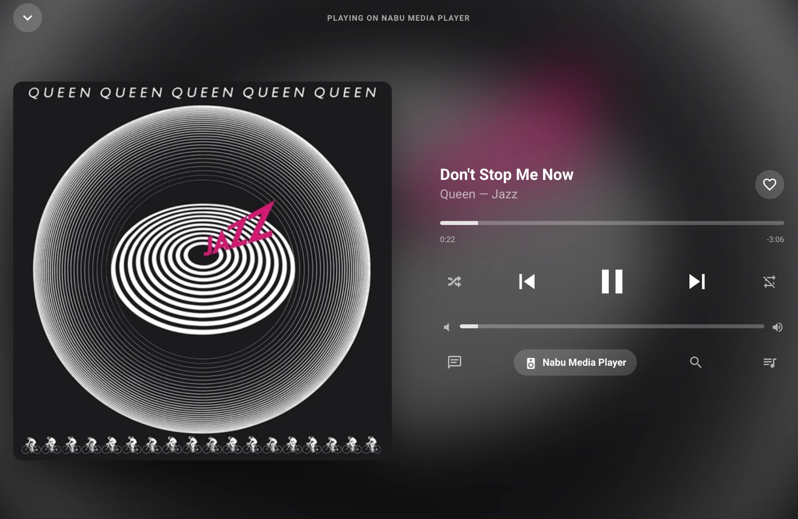
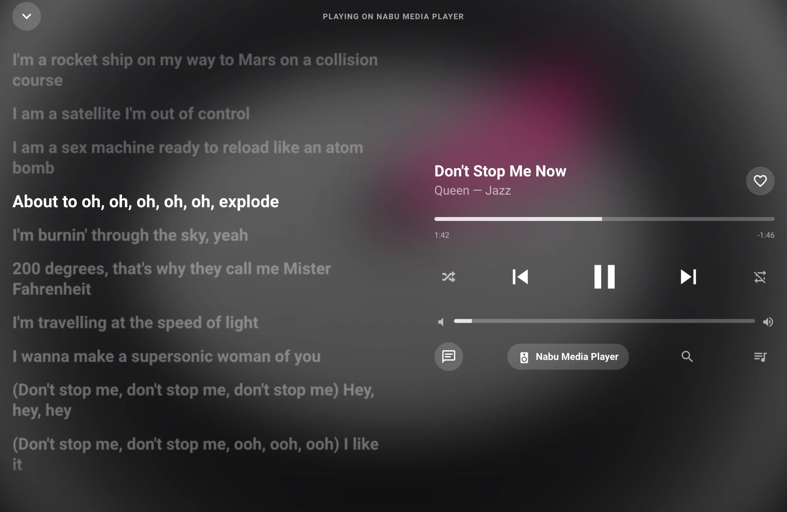
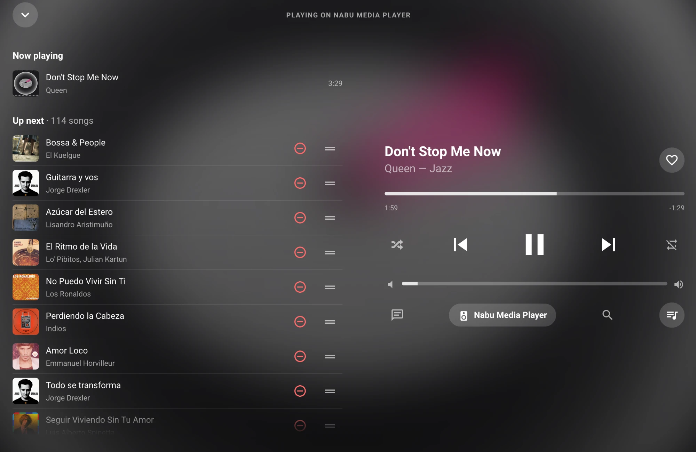
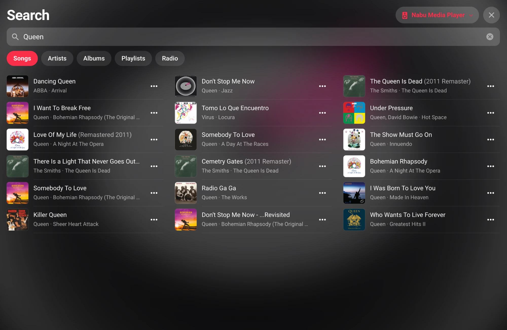
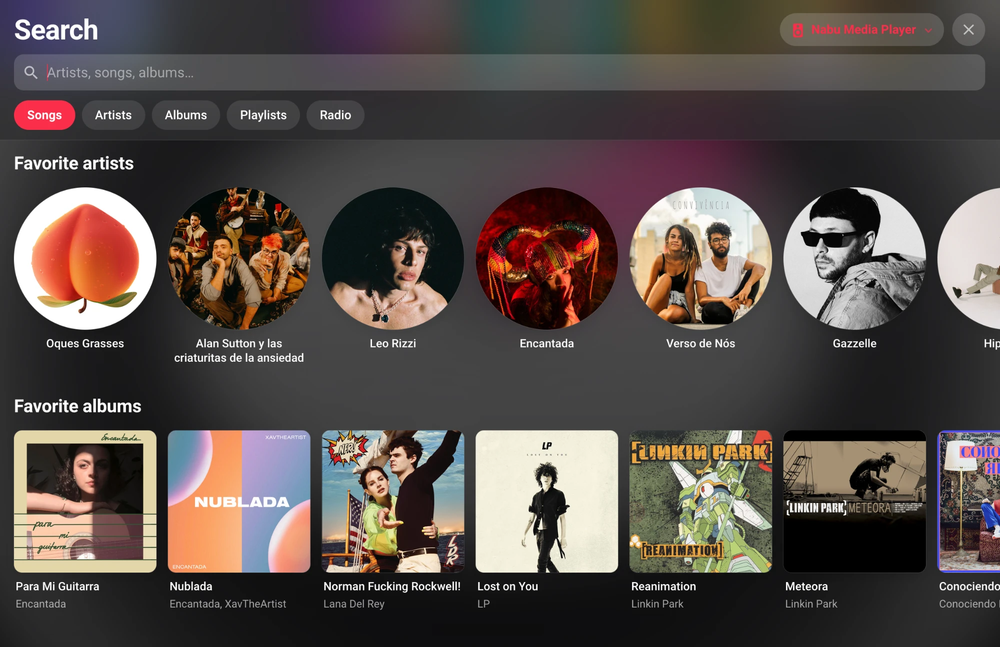
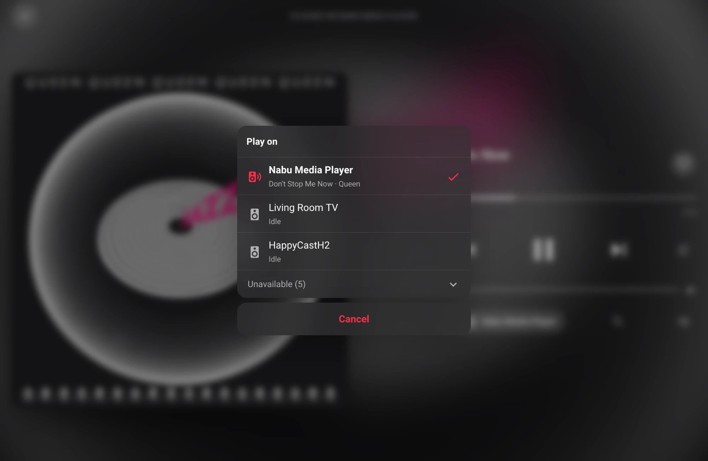

# Music Assistant Player Card

[](https://my.home-assistant.io/redirect/hacs_repository/?owner=maurobender&repository=ma-player-card&category=plugin)

A **Music Assistant** player and music browser for Home Assistant dashboards, styled after Apple Music
(unofficial, not affiliated with Apple).



One file, `ma-player-card.js`, with two cards:

| Card | What it is |
|---|---|
| `custom:ma-player-card` | What's playing, plus a full-screen **Now playing** view: controls, progress, volume, shuffle/repeat, favorite, the **queue**, **synced lyrics** and the built-in browser (🔍). |
| `custom:ma-browser-card` | The browser on its own: a button that opens search full screen, with recently played items and favorites. |

- It works with the **official** Music Assistant integration that ships with Home Assistant.
  If [`mass_queue`](https://github.com/droans/mass_queue) is also installed, the queue becomes editable (see *Backends*).
- The interface follows the language of your Home Assistant profile. English and Spanish are included; other languages fall back to English.

## Screenshots

| Synced lyrics | Queue |
|---|---|
|  |  |
| **Search** | **Browser home** |
|  |  |
| **Speaker picker** | |
|  | |

## Installation

### HACS (recommended)

1. Click the **Open in HACS** button above, or in HACS open **⋮ → Custom repositories** and add
   `https://github.com/maurobender/ma-player-card` with type **Dashboard**.
2. Download **Music Assistant Player Card**. HACS adds the dashboard resource for you.
3. Reload the browser. In the Companion app: *Settings → Companion app → Debugging → Reset frontend cache*, or close and reopen the app.

HACS lets you know when there is a new version.

### Manual

1. Download `ma-player-card.js` from the [latest release](https://github.com/maurobender/ma-player-card/releases/latest).
2. Copy it to `/config/www/` (for example with the *File editor* or *Samba* add-on).
3. **Settings → Dashboards → ⋮ → Resources → Add resource**
   - URL: `/local/ma-player-card.js?v=1`
   - Type: **JavaScript module**

   If the *Resources* menu is missing, turn on **Advanced mode** in your user profile.
4. Reload the browser, as in step 3 of the HACS install.

To update, replace the file and bump the number in the resource URL (`?v=2`, `?v=3`, …): Home Assistant and the
Companion app cache resources aggressively. The console (F12) shows the loaded version, e.g. `MA-PLAYER-CARD v0.5.1`.

## Player (`ma-player-card`)

```yaml
type: custom:ma-player-card
entity: media_player.living_room
# Every browser option (media_types, home, speakers, accent_color, columns…) works here too
queue_limit: 50     # queue songs shown
lyrics: true        # synced lyrics button
# backend: auto     # auto | native | mass_queue
```

| Option | Default | Description |
|---|---|---|
| `entity` | — (required) | Default speaker |
| `queue_limit` | `50` | Upcoming songs shown in the queue |
| `lyrics` | `true` | Shows the lyrics button |
| `lyrics_offset` | `0.6` | Seconds the lyrics run ahead of the audio. Raise it if lyrics lag; lower it (or go negative) if they run early |
| `lyrics_url` | `https://lrclib.net` | LRCLIB server, in case you host your own |
| `backend` | `auto` | `auto` uses `mass_queue` when installed; `native` forces the official integration; `mass_queue` forces mass_queue |
| `debug` | `false` | Shows a panel with the position, backend and events, for troubleshooting |
| `accent_color` and the browser options | | Passed on to the built-in browser |

**On the dashboard** the card is a row with the artwork, title, artist, ⏮ ⏯ ⏭, 🔍 and a thin progress bar.
When nothing is playing, tapping it opens the browser.

**Tapping the artwork or title** opens *Now playing* full screen:

- The background is the blurred artwork; the artwork shrinks while paused.
- ♥ adds the current song to your Music Assistant favorites. With `mass_queue`, tapping it again removes it.
- A draggable progress bar (seek) and volume. Tap the speaker icon left of the volume to mute; tap it again to
  go back to the previous volume.
- At the bottom: 💬 lyrics · speaker · 🔍 search · ☰ queue.
- While something plays, the browser uses the same background (blurred artwork, light text); otherwise it follows the HA theme.
- **Queue**: the current song and the upcoming ones (see *Backends* for what you can do with them).
- **Synced lyrics**: the current line is highlighted and the view follows along; tap a line to jump there.
  Without a synced version, plain lyrics are shown. When nothing is found, *Search on lrclib.net* opens the
  website so you can check (LRCLIB is community-run: lyrics can be added with the LRCGET app).
- Close it with the ⌄ arrow, *Esc* or Android's *back* button. *Back* closes one layer at a time: a menu, then the browser, then *Now playing*.

### Backends: official integration or `mass_queue`

The card talks to Music Assistant through a *backend*. The interface stays the same; what you can do changes:

| | `native` (official) | `mass_queue` (HACS) |
|---|---|---|
| See the queue | ✓ (full list on Home Assistant from November 2026; before that, only the next song) | ✓ always the full list |
| Tap a song to jump to it | — | ✓ |
| Drag ≡ to reorder | — | ✓ |
| Remove from the queue (⊖) | — | ✓ |
| ♥ add to favorites | ✓ | ✓ |
| ♥ remove from favorites | — | ✓ (library songs only) |
| Song durations in the queue | ✓ | — (mass_queue doesn't report them) |

With `backend: auto` (the default) there is nothing to configure: install `mass_queue` and the card picks it up.
`mass_queue` does **not** change the progress bar. The jump back to 0 after pausing or seeking on some speakers is a
Music Assistant bug ([music-assistant/support#7194](https://github.com/music-assistant/support/issues/7194)) that the
official HA card shows too; this card compensates for it.

> **Privacy:** lyrics come from [LRCLIB](https://lrclib.net), a free service with no API key.
> To find them, the device sends the song's title, artist, album and duration to lrclib.net. With `lyrics: false` nothing is sent.

## Browser (`ma-browser-card`)

With `ma-player-card` you don't need a separate browser card: 🔍 opens the same browser.
`ma-browser-card` is useful when you only want the search button, for example on another dashboard.

```yaml
type: custom:ma-browser-card
entity: media_player.living_room
mode: compact      # compact = a button that opens the browser full screen | inline = the browser inside the dashboard
name: Search music
accent_color: "#fa2d48"   # Apple Music red; "theme" uses the theme's primary color
media_types: [track, artist, album, playlist, radio]   # visible tabs, in order
limit: 20          # results per search
columns: 4         # grid columns (automatic on phones)
library_only: false   # true = search only your library
speaker_selector: true   # button to choose which speaker plays
# speakers: [media_player.living_room, media_player.kitchen]   # default: every Music Assistant player
# home: ...                # home view shelves (see below)
# config_entry_id: 01J...   # optional
```

| Option | Default | Description |
|---|---|---|
| `entity` | — (required) | Music Assistant `media_player` to play on |
| `mode` | `compact` | `compact`: a button that opens the browser full screen. `inline`: the browser inside the dashboard |
| `name` | *Search music* (translated) | Button text in `compact` mode |
| `accent_color` | `#fa2d48` | Accent color. `theme` uses the theme's `--primary-color` |
| `media_types` | `[track, artist, album, playlist, radio]` | Tabs, in order. `podcast` and `audiobook` are also available |
| `limit` | `20` | Results per search |
| `columns` | auto | Maximum columns; fewer on narrow screens |
| `library_only` | `false` | Search only the library |
| `speaker_selector` | `true` | Shows the speaker button at the top right |
| `speakers` | every MA player | Players listed in the speaker picker |
| `home` | see below | Home view shelves. `home: []` turns it off |
| `home_limit` | `20` | Items per shelf |
| `config_entry_id` | auto | Only if automatic detection fails |

### Using the browser

- **Tap the button** to open the browser full screen. With an empty search it shows your recently played items and favorites. Close it with ✕, *Esc* or Android's *back* button.
- **Type** in the search field: it searches on its own after 350 ms, or when you press *Enter*. The media type tabs (songs, artists, …) appear once there is something to search.
- **Songs** are shown as a list (1–3 columns depending on the width); everything else as an artwork grid.
- **Tap** a result to play it right away on the speaker.
  - Songs → `enqueue: play` (plays now, keeps the queue).
  - Artists, albums, playlists and radio → `enqueue: replace` (replaces the queue).
- **Long-press** (or tap **⋯**) for *Play now*, *Play next* (`next`) and *Add to queue* (`add`).
  Radio only has *Play now*.

### Home view (`home`)

Opening the browser with an empty search shows shelves that scroll sideways. Empty shelves are hidden.
The defaults, with titles in your language:

```yaml
home:
  - title: Recently played
    media_type: album
    order_by: last_played_desc
  - title: Your playlists
    media_type: playlist
    favorite: true
    order_by: favorite_timestamp_desc
  - title: Favorite artists
    media_type: artist
    favorite: true
    order_by: favorite_timestamp_desc
  - title: Favorite albums
    media_type: album
    favorite: true
    order_by: favorite_timestamp_desc
  - title: Favorite radio
    media_type: radio
    favorite: true
    order_by: favorite_timestamp_desc
```

Each shelf takes `title`, `media_type`, `favorite`, `order_by` (`last_played_desc`, `favorite_timestamp_desc`,
`play_count_desc`, `timestamp_added_desc`, `name`, `random`…) and `limit`. Without a `title`, the media type's name is used.

### Speaker picker

The button with the speaker's name (top right) lists the Music Assistant players and what each one is playing.
The choice is remembered **on that device**, so a tablet and a phone can play on different speakers.
If the chosen speaker disappears, the card goes back to `entity`.

## Development

Requires Node.js 20 or later.

```bash
npm install
```

| Command | What it does |
|---|---|
| `npm run build` | Bundles `src/` into `dist/ma-player-card.js` |
| `npm run dev` | Rebuilds on save and serves the mocks at <http://localhost:8766/player.html> and <http://localhost:8766/browser.html> |
| `npm run lint` | Lints with Biome |
| `npm run format` | Formats with Biome |
| `npm run typecheck` | Type-checks with TypeScript |
| `npm test` | Runs the tests (Vitest) |
| `npm run check` | Lint + types + tests + build |

`dist/` is a build output and is not committed. To try a local build in Home Assistant, copy
`dist/ma-player-card.js` to `/config/www/` as in the manual install.

The mocks in `dev/` fake `hass` in the browser. `?lang=es` switches either mock to Spanish. In `player.html`,
`?mq=1` fakes the `mass_queue` integration, and running `window.oldHA = true` in the console fakes a Home Assistant
version without the full queue.

### Releasing

1. Bump `version` in `package.json` (e.g. `0.6.0`), commit and push.
2. On GitHub, create a release with the tag `v0.6.0` (it must match `package.json`).
3. The *Release* workflow (`.github/workflows/release.yml`) runs `npm run check` and attaches `ma-player-card.js`
   to the release. HACS downloads the file from there.

### How it works

The cards, the queue, the lyrics and the slider are [Lit](https://lit.dev) components; Lit is bundled into the file.
The cards never call `hass` directly: everything goes through `backend/`. The library and the player controls
always use the official integration; the queue and favorites use `mass_queue` when it is installed (or forced with `backend:`).

```
src/
  main.ts                 registers the cards (entry point)
  version.ts              version (injected by the build)
  constants.ts            media types, default shelves, sizes
  models/hass.ts          types for the hass object and entities
  i18n/                   translations (en is the base; es)
  cards/
    browser-card/         ma-browser-card and its styles
    player-card/          ma-player-card, its styles, the queue (<ma-player-queue>) and lyrics (<ma-player-lyrics>)
  backend/                the only code that talks to Music Assistant
    types.ts              the contract: library, queue, favorites, player
    backend.ts            picks native or mass_queue and assembles the backend
    native/               official HA integration
    mass-queue/           queue and favorites through mass_queue
  components/             UI shared by both cards
    action-sheet.ts       iOS-style menu (<ma-player-action-sheet>)
    toast.ts              floating notice (<ma-player-toast>)
    speaker-picker.ts     the "Play on" sheet
    overlay-history.ts    the back button closes dialogs and menus
    slider.ts             progress and volume slider (<ma-slider>)
    theme.ts              color variables (light and dark)
  services/
    playback-clock.ts     song position (including the #7194 workaround)
    lyrics/               lyrics (LRCLIB and the LRC parser)
    speaker-target.ts     chosen speaker, shared between cards
    speakers.ts           speaker list and names
  utils/                  HTML escaping, formatting, ids, haptics
test/                     tests (Vitest)
dev/                      mocks for trying the cards in a browser
docs/images/              screenshots for this README
scripts/build.mjs         esbuild build
```

Music Assistant actions the cards use:

| Action | Used for | Key fields |
|---|---|---|
| `music_assistant.search` | Search | `config_entry_id`*, `name`*, `media_type` (`track`, `artist`, `album`, `playlist`, `radio`…), `limit` (default 5), `library_only` |
| `music_assistant.get_library` | Home view: recently played and favorites | `config_entry_id`*, `media_type`*, `favorite`, `order_by`, `limit` (default 25) |
| `music_assistant.play_media` | Play | target `entity_id`*, `media_id`* (URI), `media_type`, `enqueue` (`play`, `replace`, `next`, `replace_next`, `add`) |
| `music_assistant.get_queue` | Queue (read-only) and favorite state | target `entity_id`*, `limit`, `offset` |
| `media_player.*` | Controls | `media_play_pause`, `media_previous_track`, `media_next_track`, `media_seek`, `volume_set`, `shuffle_set`, `repeat_set` |
| `button.press` | ♥ Favorite | The *Favorite current song* button Music Assistant adds to each player |
| `mass_queue.*` (optional) | Edit the queue, remove a favorite | `get_queue_items`, `move_queue_item_up/down/next`, `remove_queue_item`, `play_queue_item`, `unfavorite_current_item` (an `entity` field, not a target) |

`config_entry_id` is detected from the entity, or can be set in the YAML.

### Adding a language

Copy `src/i18n/es.ts` to a new file named after the language code (e.g. `fr.ts`), translate the values, and add it to
`LANGUAGES` in `src/i18n/index.ts`. The `Translations` type makes the build fail if a key is missing.

## License

[MIT](LICENSE)
